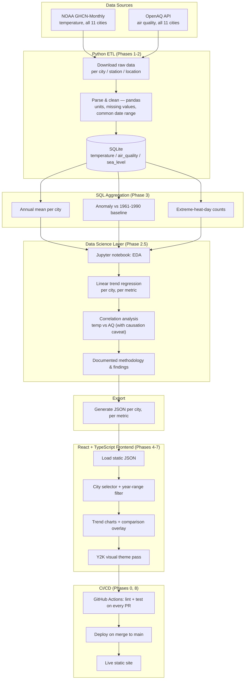

# Project Roadmap — Warming Cities (working title)

A static-data, interactive climate storytelling site. Python cleans, aggregates, and statistically
models 50+ years of per-city temperature data (plus air quality, and sea level for coastal cities)
into SQLite, exports the results to JSON, and a React/TypeScript frontend renders it as an
explorable, Y2K-styled experience. No backend server at runtime.

This document is the build plan: what gets built in what order, how git history should look along
the way, and how CI/CD is wired in from day one rather than bolted on at the end. Treat each phase
below as one feature branch and one pull request into `main`.

---

## Cities

Lahore, Beijing, São Paulo, Addis Ababa, New York, Delhi, Ho Chi Minh City, Jakarta, London,
Sydney, Santiago — eleven cities spanning six continents and both hemispheres, mixing
long-baseline developed-world stations (London, New York, Sydney) with the climate-risk-hotspot
megacities that carry the "how hot is the world getting" narrative (Delhi, Beijing, Lahore,
Jakarta, Ho Chi Minh City, Addis Ababa).

Changed during Phase 1: Manila and Cairo were swapped for Ho Chi Minh City and Addis Ababa, and
Santiago was added, because OpenAQ only has PM2.5 for Manila and Cairo from 2023 — too short to
show a trend. Each replacement has PM2.5 from 2016 and a GHCN temperature record covering the
1961–1990 baseline.

## Datasets

| Metric | Source | Coverage | Notes |
|---|---|---|---|
| Temperature | [NOAA GHCN-Monthly](https://www.ncei.noaa.gov/products/land-based-station/global-historical-climatology-network-monthly) | All 11 cities, 50+ years (London's Central England Temperature record runs to 1659) | Primary metric, baseline = 1961–1990 |
| Air quality (PM2.5 primary) | [OpenAQ API](https://docs.openaq.org/about/about), supplemented by [WHO Ambient Air Quality Database](https://www.who.int/data/gho/data/themes/air-pollution) | All 11 cities, from 2016 at the earliest (Lahore from 2019; Sydney ends 2022, Ho Chi Minh City 2024) — document this shorter window explicitly, don't extrapolate backward | Core secondary metric. Pulled as monthly aggregates with coverage stats |
| ~~Sea level~~ | [PSMSL](https://psmsl.org/) tide-gauge records | Deferred to v2 | Local relative sea-level change mixes land subsidence (dominant in Jakarta), tectonics and global rise — out of scope for this version |

## Pipeline overview



---

## 0. Ground rules for a portfolio-grade git history

These apply for the whole project, not just one phase.

**Branching.** `main` is always deployable. Every unit of work happens on a branch named
`type/short-description` — e.g. `feat/etl-download`, `fix/anomaly-calc`, `chore/ci-setup`,
`docs/readme-methodology`. Never commit directly to `main`; open a pull request even though you're
the only reviewer. This is what makes your GitHub activity look like a real engineering process
instead of a pile of commits on one branch — a hiring manager skimming your repo can see discrete,
reviewable units of work with descriptions.

**Commit messages.** Use Conventional Commits: `<type>: <short summary>`, types being `feat`,
`fix`, `docs`, `refactor`, `test`, `chore`, `style`, `ci`. Example history for one small unit of work:

```
feat: add NOAA GHCN download client
test: add unit tests for download client retry logic
docs: document data source and license in README
```

Each commit should be one logical change you could describe in one sentence — not "wip", not "more
stuff", and not one giant commit containing the entire phase. Aim for commits you'd be comfortable
explaining line-by-line in an interview.

**Pull requests.** Even solo, open a PR per branch with a short description: what changed, why, how
you verified it. Merge with "Squash and merge" if the branch has messy WIP commits, or a regular
merge if the commit history within the branch is already clean and worth preserving. Delete the
branch after merge. This gives you a PR history — timestamps, descriptions, CI checks passing — that
reads as process, which is exactly what "professional" means in a portfolio context.

**Cadence.** Don't let a phase sit as one uncommitted blob for days and then land as a single commit.
Commit at each point you'd feel safe reverting to: after the download script works, after cleaning
handles missing values, after tests pass, after docs are updated. A repo with a steady trail of small,
well-described commits over weeks reads far better than a repo with three 40-file commits.

---

## 1. CI/CD strategy

Set this up in Phase 0, before there's much code to check — an empty pipeline that passes is more
useful early than a full pipeline retrofitted later.

**Continuous Integration** (`.github/workflows/ci.yml`), runs on every push and every PR into `main`:

- Python job: install deps, run `ruff` (lint) and `pytest` (unit tests on the ETL pipeline).
- Frontend job: install deps, run `eslint`, run `tsc --noEmit` (type check), run the build (`vite build`).
- Both jobs run in parallel; the PR can't merge if either fails (enable "Require status checks to
  pass" in branch protection settings on `main`).

Minimal example:

```yaml
name: CI
on:
  push:
    branches: [main]
  pull_request:
    branches: [main]

jobs:
  python:
    runs-on: ubuntu-latest
    defaults:
      run:
        working-directory: etl
    steps:
      - uses: actions/checkout@v4
      - uses: actions/setup-python@v5
        with:
          python-version: "3.12"
      - run: pip install -r requirements.txt
      - run: ruff check .
      - run: pytest

  frontend:
    runs-on: ubuntu-latest
    defaults:
      run:
        working-directory: web
    steps:
      - uses: actions/checkout@v4
      - uses: actions/setup-node@v4
        with:
          node-version: "20"
      - run: npm ci
      - run: npm run lint
      - run: npx tsc --noEmit
      - run: npm run build
```

**Continuous Deployment** (`.github/workflows/deploy.yml`), runs only on push to `main` (i.e. after
a PR merges):

- Build the frontend, deploy to Vercel or GitHub Pages.
- If using GitHub Pages: build step outputs static files, then `actions/deploy-pages` publishes them.
- If using Vercel: connecting the repo in the Vercel dashboard gives you this for free without a
  custom workflow file — worth doing that instead of hand-rolling it, less to maintain.

Add a status badge to your README once this is live (``)
— small detail, but it's the first thing a technical reviewer's eye goes to.

---

## 2. Build phases

Each phase = one branch, one PR, ends with CI green and `main` still deployable.

### Phase 0 — Repo & tooling setup
Branch: `chore/repo-setup`

- `git init`, `.gitignore` (Python + Node + OS junk + `.env`), MIT or similar license, README stub.
- `etl/` (Python) and `web/` (React/TS via Vite) as sibling directories in one repo (a monorepo is
  fine at this scale — no need for two repos).
- Python: `ruff` + `pytest` configured. Frontend: `eslint` + `prettier` + `tsc` configured.
- `.github/workflows/ci.yml` in place, even with almost nothing to lint yet — confirm it goes green.
- Branch protection on `main`: require PR, require CI to pass.

**Definition of done:** empty-ish repo, CI pipeline passing, README explains what the project will be.

### Phase 1 — Data acquisition
Branch: `feat/data-download`

- City list locked: Lahore, Beijing, São Paulo, Addis Ababa, New York, Delhi, Ho Chi Minh City,
  Jakarta, London, Sydney, Santiago.
- Script to download raw monthly temperature series per city from NOAA GHCN-Monthly.
- Script to pull air-quality history per city from the OpenAQ API (PM2.5 primary), plus a WHO
  Ambient Air Quality Database pull as a supplementary/longer-range reference.
- Cache raw downloads in `data/raw/` (gitignored if large; commit a small sample or a fetch script
  instead of huge raw files).
- Unit tests: each download client handles a missing city / network failure gracefully.

**Definition of done:** running the scripts produces raw temperature and air-quality files for
every city, with tests passing in CI.

### Phase 2 — Cleaning & validation
Branch: `feat/etl-cleaning`

- pandas: parse raw files per dataset, handle missing months (documented strategy — interpolate vs.
  drop), normalize units (°C, µg/m³, mm), align each dataset to a common annual granularity even
  though native resolution differs (temperature monthly, AQ often daily/hourly, sea level monthly).
- Data quality checks: assert no duplicate (city, year) rows, assert values are in a sane physical
  range per metric, flag gaps longer than N months — and explicitly record each city's actual AQ
  data start year rather than assuming full 50-year coverage.
- Tests on the cleaning functions with small fixture data (not the full real dataset).

**Definition of done:** one command turns raw files into clean, validated pandas DataFrames per city,
per dataset.

### Phase 2.5 — Exploratory analysis & statistical modeling
Branch: `feat/eda-modeling`

- New: `notebooks/exploratory_analysis.ipynb`, checked into the repo — this is where the project
  earns the "data science" label rather than just "data engineering."
- Linear trend regression per city per metric (report as °C/decade for temperature).
- Rolling multi-year average per city to smooth year-to-year noise.
- Correlation analysis between temperature and air-quality trends per city, with an explicit written
  caveat that correlation here does not imply causation — warming is driven by global greenhouse gas
  concentrations, air quality by local pollution sources, and they are largely independent
  mechanisms that happen to co-occur.
- Optional: a clearly-labeled naive linear projection a decade or two forward.
- Output: documented findings (markdown or notebook narrative) that Phase 3's export step draws its
  final numbers from.

**Definition of done:** a reviewable notebook with regression results, correlation findings, and
written methodology/caveats — this is the artifact that proves statistical reasoning, not just
plumbing.

### Phase 3 — Aggregation (SQL) & export
Branch: `feat/aggregate-export`

- Load cleaned data into SQLite: `temperature`, `air_quality`, `sea_level` tables.
- Write SQL for: annual mean per city, anomaly vs. the 1961–1990 baseline, extreme-heat-day counts,
  annual AQ mean, annual sea-level mean (coastal subset).
- Pull in the Phase 2.5 derived values (trend slope, correlation coefficients) as additional fields.
- Export query results to `web/public/data/*.json`, one file (or object) per city.
- Test: assert exported JSON matches expected shape and a known reference value (sanity check
  against a published figure for at least one city, so you can defend the numbers if asked).

**Definition of done:** the SQLite DB and the exported JSON are reproducible from raw data by running
the pipeline end to end, including the derived statistical fields.

### Phase 4 — Frontend scaffold
Branch: `feat/frontend-scaffold`

- Vite + React + TypeScript app in `web/`.
- Basic layout shell, routing if needed, data loading from the exported JSON.
- CI's frontend job now has something real to lint/build.

**Definition of done:** app builds and deploys showing raw, unstyled data — proves the pipeline is
wired end to end before any design work starts.

### Phase 5 — Core charts
Branch: `feat/charts-core`

- Line chart of annual mean / anomaly per city over time.
- City selector.
- (Chart styling and color system get a proper pass later — functional first.)

### Phase 6 — Interactivity
Branch: `feat/interactivity`

- Year-range filter, multi-city comparison/overlay mode, hover/tooltip detail.

### Phase 7 — Visual design pass (Y2K)
Branch: `feat/ui-theme`

- Typography, color, chrome/gradient treatments, layout polish — the visual identity of the piece.
- Keep this its own phase/PR so the "make it functional" and "make it look right" work stay
  separable in the git history.

### Phase 8 — Deployment pipeline
Branch: `chore/cd-deploy`

- Wire up `deploy.yml` (or connect Vercel), confirm production deploy works on merge to `main`.
- Add the CI badge and a live link to the README.

### Phase 9 — Documentation & polish
Branch: `docs/final-writeup`

- README: what this is, data sources + license for each dataset (NOAA, OpenAQ, WHO, PSMSL),
  methodology (baseline period, how anomalies are computed, the temp-vs-AQ correlation caveat, the
  Jakarta subsidence note), screenshots or a short GIF, link to the live site.
- A short "Roadmap / what's next" section naming the v2 idea explicitly: a FastAPI + Postgres
  backend with a scheduled monthly refresh job, replacing the static JSON snapshot. Framing this as
  a deliberate next step, not a missing feature, is worth doing well.

---

## 3. Suggested order of operations, week by week (adjust to your pace)

1. Phase 0–1 — repo, CI, data download working (temperature, air quality).
2. Phase 2 — cleaning and validation across all three datasets.
3. Phase 2.5 — exploratory analysis notebook: trend regression, correlation analysis, documented caveats.
4. Phase 3 — SQL aggregation and JSON export, including the derived statistical fields.
5. Phase 4–5 — frontend scaffold, core charts rendering real data.
6. Phase 6 — interactivity.
7. Phase 7 — visual design pass.
8. Phase 8–9 — deployment pipeline, README, polish, ship.

Each week should end with `main` deployable and CI green — never leave `main` in a broken state
between sessions.

---

## 4. v2 (not this project, but worth stating up front)

FastAPI + Postgres backend, live queries replacing static JSON, a scheduled GitHub Action or cron
job that pulls the newest year of data monthly. Stated explicitly in the README as intentional
future work.
